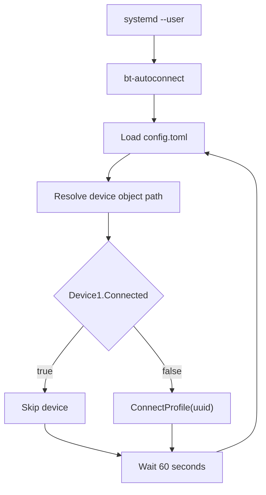

# bt-autoconnect

## What?

A user-level daemon that automatically reconnects configured Bluetooth profiles through the BlueZ D-Bus API.

## Why?

BlueZ does not automatically reconnect a device simply because it is paired and trusted. This daemon reproduces the periodic reconnection behavior of Blueman's AutoConnect plugin without requiring Blueman to run.

- Uses BlueZ D-Bus directly instead of invoking `bluetoothctl`.
- Checks device connection state every 60 seconds.
- Connects explicitly configured profiles through `ConnectProfile()`.

## How?

### File map

| Repository path | Installed path |
|---|---|
| `home/.local/bin/bt-autoconnect` | `~/.local/bin/bt-autoconnect` |
| `home/.config/bt-autoconnect/config.toml` | `~/.config/bt-autoconnect/config.toml` |
| `home/.config/systemd/user/bt-autoconnect.service` | `~/.config/systemd/user/bt-autoconnect.service` |

### Runtime flow



The daemon runs an initial check at startup, then repeats every 60 seconds through GLib. D-Bus `PropertiesChanged` signals update connection-state tracking but do not initiate reconnection.

### Main functions

| Function | Responsibility |
|---|---|
| `load_config()` | Reads `~/.config/bt-autoconnect/config.toml`. |
| `get_device_path()` | Resolves a device MAC address to its BlueZ object path. |
| `connect_profile()` | Calls `Device1.ConnectProfile()` for a configured UUID. |
| `process_device()` | Checks connection state and attempts configured profiles when disconnected. |
| `on_properties_changed()` | Tracks `Connected` property changes and logs disconnections. |
| `main()` | Initializes D-Bus, registers signal handling, schedules checks, and runs the GLib loop. |

### Configuration

`~/.config/bt-autoconnect/config.toml`

```toml
[[device]]
address = "41:42:3D:xx:xx:xx"

services = [
    "0000110b-0000-1000-8000-00805f9bxxxx"
]
```

Each `[[device]]` entry specifies a Bluetooth MAC address and the profile UUIDs to connect. The example UUID represents the Audio Sink (A2DP) profile.

### Dependencies

**Required packages**

| Package | Purpose |
|---|---|
| `python` | Runtime and `tomllib` |
| `python-dbus` | BlueZ D-Bus communication |
| `python-gobject` | GLib main loop and timer |
| `bluez` | Bluetooth service |

```bash
sudo pacman -S --needed python python-dbus python-gobject bluez
```

### Service lifecycle

```bash
systemctl --user enable --now bt-autoconnect.service
systemctl --user status bt-autoconnect.service
journalctl --user -u bt-autoconnect.service
systemctl --user restart bt-autoconnect.service
```

### Related components

| Component | Responsibility |
|---|---|
| BlueZ | Bluetooth device management and profile connections |
| D-Bus | Communication with BlueZ |
| GLib | Event loop and periodic scheduling |
| systemd user manager | Daemon lifecycle and restart policy |
| Blueman AutoConnect | Existing implementation whose polling behavior this daemon follows |

### Remove

```bash
systemctl --user disable --now bt-autoconnect.service
rm -f ~/.config/systemd/user/bt-autoconnect.service
rm -f ~/.local/bin/bt-autoconnect
rm -rf ~/.config/bt-autoconnect
systemctl --user daemon-reload
systemctl --user reset-failed
```

### Implementation limitations

- No explicit configuration schema or value validation.
- No retry backoff; failed connections are retried every 60 seconds.
- No reconnect action is triggered directly by disconnection or Bluetooth power-state signals.
- No per-profile connection-state checks.
- Device resolution depends on matching the transformed MAC address against the BlueZ object-path suffix.
- `time` is imported but unused.
